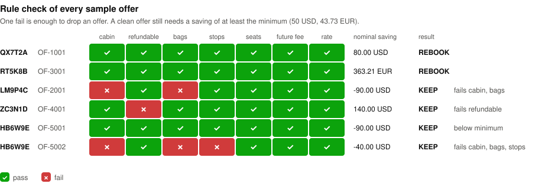
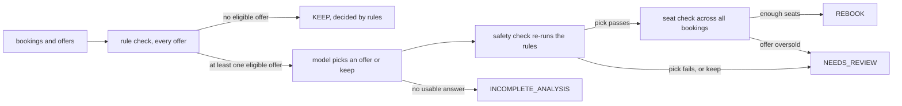
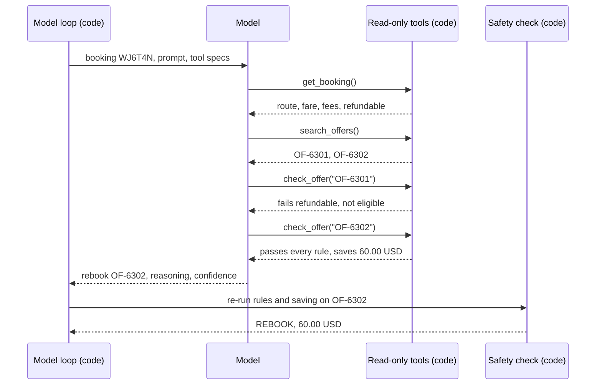
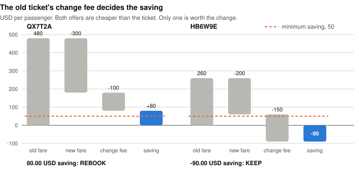
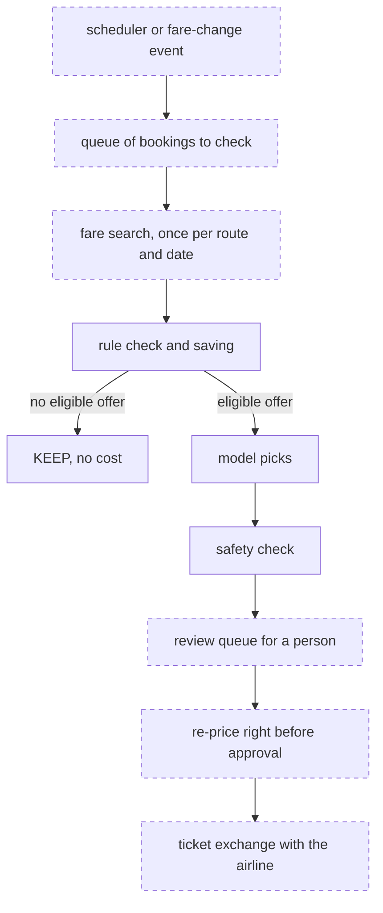

# Design

This is why the tool works the way it does. [README.md](README.md) says what it does, how to run it and what it prints. Terms are defined in [GLOSSARY.md](GLOSSARY.md). Decisions that are hard to undo have an ADR in [docs/adr/](docs/adr/).

## How I framed the problem

The data does not say when two fares are "equivalent" or when a rebooking is "worth it". I chose these definitions:

- An offer matches a booking when it has the same origin, destination and departure date as the booking. It may be a different flight.
- A matching offer is eligible when it passes every hard rule and its saving meets the minimum of 50 USD.
- The traveler must not lose anything they paid for. Each of these fails the offer:

| Rule | Fails when |
|---|---|
| cabin | the offer's cabin is lower (basic economy < economy < premium economy < business < first) |
| refundable | the booking is refundable and the offer is not |
| bags | the offer includes fewer checked bags |
| stops | the offer has more stops |
| seats | the offer has fewer seats left than the booking has passengers |
| future change fee | changing the new fare later costs more than changing the old ticket today |
| exchange rate | an amount is in another currency and no rate exists to convert it |

A schedule change or a carrier change does not fail an offer. It adds an approval flag, because a 20-minute shift is fine for some travelers and not for others. Only the person reviewing the result can judge that.



I made the tool recommend, never act. The data has no binding price from the airline, so no saving in it is safe to execute on. Automatic rebooking is a business decision. I list it as an open question below.

## How a booking flows



1. The input files are parsed into typed values. A booking with bad data becomes `INVALID_DATA`, and the rest of the run goes on. Examples of bad data: a total that is not passengers times price, more than one flight segment, or a departure before the snapshot time.
2. Code finds the matching offers and runs every rule on each one. It computes the saving and adds approval flags.
3. If no offer is eligible, the result is `KEEP`, and the model is never called. On the sample data this settles 3 of 5 bookings.
4. Otherwise the model looks at the booking through read-only tools and answers with a pick or keep, a short reason and a confidence.
5. The safety check re-reads the booking and the offer the model named, and runs the rules and the money math again. The model's answer contains no amounts, so every figure in the result comes from code.
6. After every booking has a result, a seat check looks at them together. Each booking passes the seats rule on its own, but two bookings can want the same offer. If the offer cannot seat them all, each of them becomes `NEEDS_REVIEW`, and a person picks which one gets the seats. In the scenarios, CH8L5F and FD2N8Z need 4 seats on an offer with 3.

## Where the model is and is not used

| Decision | Made by | Why |
|---|---|---|
| Which offers match a booking | code | A lookup by route and date. No judgment needed. |
| Hard rules | code | Each is a yes or no on fields in the data. A model can only get these wrong. |
| Money: saving, fees, currency | code | It must be exact and repeatable. |
| Which eligible offer, or keep | model | Trade-offs between flags and savings need judgment. Example: 170 USD with a 40-minute schedule change, or 80 USD with no change. |
| Reasoning text for the person | model | Plain language about the trade-off. |
| Whether the pick is allowed | code | The safety check. |

The model has three tools: `get_booking`, `search_offers` and `check_offer`. Code binds each tool to one booking, so the model cannot read another booking. No tool writes anything. The final answer has four fields: `decision`, `offer_id`, `reasoning` and `confidence`. The provider enforces that shape with strict structured output. Code checks it again.

This is the recorded run for WJ6T4N, from the scenarios data set. The booking is refundable. One offer is cheaper but not refundable.



The prompt is in [review_prompt.md](fare_reshop_agent/reshopping/orchestration/review_prompt.md). It tells the model three things. Code has already checked the offers. It may pick an eligible offer that is not the cheapest, if it says why. A person reads every answer.

What can go wrong with the model, and what happens then:

| Model behavior | Result |
|---|---|
| Picks an eligible offer | `REBOOK`. If it is not the highest saving, `best_offer_id` names the highest one. |
| Picks an offer that fails a rule, misses the minimum or does not exist | `NEEDS_REVIEW`, with the failed check and the model's text side by side |
| Says keep while an eligible offer exists | `NEEDS_REVIEW`, because a missed saving should not pass unseen |
| Loops, repeats a call, breaks the answer shape, refuses, or the provider fails | `INCOMPLETE_ANALYSIS` with the reason. The other bookings still run. |

A booking gets at most 10 model turns. The same tool call twice in a row ends it.

### What the recorded runs show

The default run replays two committed recordings of the real model (gpt-5.4-mini), one per data set, so it needs no key ([ADR 0004](docs/adr/0004-recorded-replay-default.md)). Across both data sets the model saw 7 bookings, and the recordings show four things:

- It picked the same offer the rules ranked highest every time. On this data the model adds reasoning text, not a different decision.
- In WJ6T4N it checked the cheaper non-refundable offer, saw it fail, and picked the refundable one.
- Its confidence was 0.98 or 0.99 on every booking. That number carries no information here. The output labels it "model estimate, not calibrated".
- Its text can be wrong. For CH8L5F, which has 2 passengers, it wrote "saves $80 per passenger". The real saving is 80 USD in total, so 40 USD per passenger. Code ignores amounts in the text, but a person reads it, so the structured `nominal_saving` field is the figure to trust. A check that compares the amounts in the text with the computed ones would not catch this, because 80 is the right number. The fix I would make is to let code write the money sentence and the model write only the trade-off.

### Is the model needed here?

For this data, no. Every fact is a clean field, and every recorded pick matches "take the biggest eligible saving". Plain code with a short template for the reason text would give the same results for free. [ADR 0002](docs/adr/0002-plain-code-rule-check-and-safety-check.md) keeps that as the fallback.

I kept the model because real reshop data is less tidy than these files. These are cases I expect in real data, and none of them is in this data set:

- Fare rule text. The penalties part of a fare rule often comes as semi-structured text, such as "CHANGES PERMITTED ... CHARGE USD 100 ... NON-REFUNDABLE AFTER DEPARTURE". A model can read whether the new fare really keeps the same change and refund terms.
- Traveler notes. A profile note like "no red-eye flights, keep AA for status" decides between two eligible offers. No rule in this build can see it.
- Several flags at once. A bigger saving with a carrier change and a later arrival, against a smaller one with no change. Without a traveler policy, someone has to weigh them and explain the choice to the person approving it.

Once such facts arrive as structured fields, such as a `noRedEye` preference or a parsed penalty amount, plain code should handle them again. The model belongs only on the part that stays unstructured.

## Money safety

- All money is `Decimal`, parsed from the JSON without passing through float. The tests fail if a float ever touches a `Decimal`.
- Every amount carries its currency. Adding or comparing two currencies without a conversion raises an error.
- Saving = passengers x (old price per passenger - offer price per passenger, converted to the booking's currency - old ticket's change fee per passenger).
- The saving is rounded once, half-even to cents. The minimum check uses that rounded value, so the check and the printed number cannot disagree.
- The minimum is one amount, 50 USD, in [config/policy.toml](config/policy.toml). For a euro booking it is converted to 43.73 EUR.
- Every converted amount shows the rate, its direction and its date in the output.

There are two change fees, and mixing them up is the easiest mistake to make. The old ticket's fee is the cost of changing today, and it is subtracted from the saving. The offer's fee is the cost of changing the new fare later. It only feeds the future change fee rule and is never subtracted. In the sample, the old ticket's fee is what decides HB6W9E:



RT5K8B is the cross-currency case. The ticket cost 2,200 EUR. The offer is 2,100 USD, which is 1,836.79 EUR at 1 EUR = 1.1433 USD. The saving is 363.21 EUR, and the result is `REBOOK`.

I decided that an offer in another currency can be used for the exchange, as long as a rate exists to compare the prices. The AI was skeptical here. It doubted that an airline would exchange a ticket sold in EUR for a fare sold in USD, and leaned toward treating such offers as unusable. The doubt is fair, but blocking would throw away the biggest saving in the sample over a question a person can answer when approving. Whether an airline accepts a USD fare for a ticket sold in EUR depends on its point-of-sale rules, and the data does not have them.

Two things about this result are not handled. The rate is a fixed demo rate dated the day before the snapshot, not a live or binding one. The 363 EUR margin covers a large rate move. And nothing tells the person that the currency changes. A `currency_change` approval flag would, and it is the first item in [future-work.md](docs/future-work.md). Adding it changes what the model sees, so it needs a new recording.

Every saving here is nominal. If the airline pays the price difference as a voucher, or keeps it, the real saving is lower or zero. I list this as an open question.

Confidence is null when the rules decide. A rules result is not a guess, and a made-up number would look like a measurement.

## Output

The JSON output has `schema_version: 1`. Adding a field keeps that version, and renaming or removing a field needs a new one. Each result has a `status`, and `decided_by` says which step decided it:

| Status | `decided_by` |
|---|---|
| `REBOOK` | `rules` in rules-only mode, `model` in model modes |
| `KEEP` | `rules` |
| `NEEDS_REVIEW` | `safety_check`, which includes the seat check |
| `INCOMPLETE_ANALYSIS` | null |
| `INVALID_DATA` | `rules` |

Each result also lists every matching offer with all seven rule results and their reasons, so a person can see why an offer lost. In model modes it carries a trace: tool calls, turn count, token usage and the prompt version.

## Scale, cost and observability

This is how I would run it on a large book of bookings. Solid boxes exist today. Dashed boxes are planned.



At volume, fare search comes first. Here the offers come from one file. A real system calls a fare source for each booking, and each call costs money and is rate-limited. The fix is to search once per route and date and share the result across all bookings on it. I do not know the price per search, and it is the first number I would ask for.

Other things that break with volume:

- The run is sequential and holds everything in memory. A real run needs a queue, retries with backoff and progress saved per booking, so a crash does not restart the whole book.
- Fares change by the minute. A recommendation from the morning can be wrong by the afternoon. The offer must be re-priced right before a person approves it.
- The seat check only sees the bookings in one run. Two runs, or a booking changed by someone else, can still compete for the same seats. Only the airline's live inventory settles that, at the moment of the exchange.

Model cost, measured from the recordings at gpt-5.4-mini prices (0.75 USD per million input tokens, 4.50 USD per million output tokens, checked on 2026-11-02):

| Data set | Bookings sent to the model | Tokens in / out | Total cost | Per model booking |
|---|---|---|---|---|
| sample | 2 of 5 | 6,403 / 261 | 0.0060 USD | 0.0030 USD |
| scenarios | 5 of 6 | 17,820 / 664 | 0.0164 USD | 0.0033 USD |

To get these numbers from a recording:

```sh
IN_USD_PER_MTOK=0.75 OUT_USD_PER_MTOK=4.50 uv run python scripts/cost.py recordings/review-run.json fixtures/pnrs.json
IN_USD_PER_MTOK=0.75 OUT_USD_PER_MTOK=4.50 uv run python scripts/cost.py recordings/scenarios-run.json fixtures/scenarios/pnrs.json
```

The cost grows with the number of bookings that have an eligible offer, not with the whole book. Say 1 million bookings are checked and 10% reach the model (a share I made up): one full pass costs about 300 USD in model calls. Fare search will likely cost more.

What I would watch:

- The share of results by status and by `decided_by`. These already come out of the JSON.
- The safety check's veto rate and how often the model disagrees with the rules. A rise means the model or the prompt drifted.
- The rate of `INCOMPLETE_ANALYSIS`, by reason.
- Tokens and cost per booking. These already come out of the trace.
- Nominal saving against realized saving on approved rebookings. This is the number that says whether the system makes money, and nothing measures it yet.

If someone changes a fixture, the recorded model run no longer matches. The run then stops with exit code 3, names what changed, and points to `--model none`, which needs no key. It never replays a model answer to a question that is no longer asked ([ADR 0004](docs/adr/0004-recorded-replay-default.md)).

Data handling: in the live mode the booking and offer facts go to OpenAI. The committed recordings hold booking references and the model's text. The data is made up and has no names or contact data. Real data would need masking before it reaches the model or a recording. Requests set `store` to false, and no key or request id is saved.

## Assumptions

| Assumption | If wrong |
|---|---|
| One minimum saving, 50 USD, converted per booking | Offers near the line flip between REBOOK and KEEP. It is one value in the policy file. |
| 1 EUR = 1.1433 USD, dated 2026-07-07 | Every euro figure moves, including RT5K8B's saving. |
| An offer in another currency can be used for the exchange | RT5K8B, the biggest saving in the sample, is not possible. A person sees the currencies in the result. |
| A booking's change fee is in the ticket's currency | The code converts it anyway, so the saving then depends on the rate. |
| Departure times are local clock times with no zone | The check "departs before the snapshot" compares a local time with a UTC time. It can be off by the airport's UTC offset: 4 hours at JFK in summer, 5 in winter. It matters only for flights that leave within a few hours of the snapshot. |
| The fixtures hold no personal data | Real data must be masked before a live run. |

## Questions for the business

- Is the old ticket's leftover value paid back as cash, as a voucher, or not at all? This decides whether the nominal saving is real, so I would ask it first.
- How big a schedule change is fine without asking the traveler? Today any change needs approval.
- Can an offer sold in one currency or market be used to change a ticket sold in another?
- Should the minimum saving be a flat amount, a percentage of the fare, or per passenger?
- When, if ever, may the tool act without a person? My proposal is a narrow class first: same flight, same conditions, saving above a threshold. It would run in shadow mode until its decisions match what people approve.
- How many bookings, how often, and what budget per booking? This sets how much model use is affordable.

## What I left out, and what comes next

I kept the build small. It has the rules, the money math, the model boundary and the safety check. These are not built:

- A model step before the rules. It would pay for calls that code settles for free, and it could drop real savings.
- Token and cost budgets per booking. The turn cap limits one booking for now.
- Multi-segment trips and time zones.
- Anything live: rates, fares and a review queue.

What I would build next, in order:

1. A `currency_change` flag, and re-pricing right before approval.
2. A labeled eval set, so a prompt or model change can be measured instead of guessed.
3. Shared fare search per route and date, with retries and saved progress.
4. Residual value of the old ticket, once the business answers the cash or voucher question.

The full list with reasons is in [docs/future-work.md](docs/future-work.md).

## How I used AI tools

I used Claude Code throughout. In the design phase it laid out options and trade-offs for each decision, and I picked one. It then wrote the plans and the code. A separate reviewer agent checked each step before the next one started.

Suggestions I rejected:

- A model step that checks every booking before the rules. It looked flexible, but the rules are free and exact, and a model in front of them can drop a real saving without anyone seeing it. So the rules run first, and the model only sees what they let through.
- Treating offers in another currency as unusable. The AI doubted that an airline would accept a USD fare for a EUR ticket. The doubt is fair, but blocking would have thrown away RT5K8B's 363 EUR saving, so I made it an assumption and an open question instead ([Money safety](#money-safety)).
- Six tools for the model. Two of them always returned the same result, and two answered only one question, so I cut them to three.

Review also caught a real bug in code the AI wrote. The first cost script printed `NaN` as a cost and exited with success when a price variable held `NaN`. It now rejects any price that is not a plain decimal number.

## Tests

`./scripts/check.sh` runs format, lint, strict type checks and the test suite, all offline. The tests cover each rule, the money math and rounding, the output contract, the model loop's failure paths with a scripted model, and the OpenAI adapter with a stub client. They also check that both committed recordings match the current data and replay to the same results.

The tests do not show that the model picks well or writes good reasons. Only a labeled eval set can show that.
