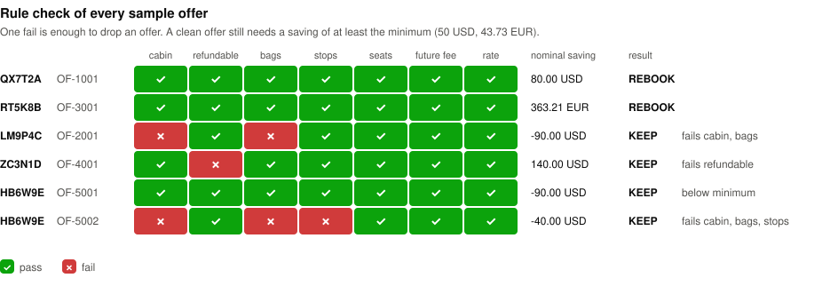

# fare-reshop-agent

Airfares often drop after you buy the ticket. Rebooking at the lower fare pays off only when the drop beats the change fee, and only when the new fare takes nothing away from the traveler, such as a checked bag or the right to a refund.

This tool reads booked flights and a snapshot of fares on sale, and gives one recommendation per booking: rebook or keep, which fare, why, and the saving after the change fee. Plain code does all the money math and the hard rules. A language model only chooses between fares that code has already approved, and code checks its choice again. Nothing is booked, and every result goes to a person. The default run needs no API key and no network.

## Try it

You need macOS or Linux. Run:

```sh
./start.sh
```

The script asks before it changes anything. It installs [uv](https://docs.astral.sh/uv/) if it is missing, and uv fetches Python 3.12 if needed. It then sets up the project, checks the setup, and prints both demo data sets as tables.

If you already have uv, these three commands do the same:

```sh
uv sync
uv run fare-reshop review --format table
uv run fare-reshop review --data scenarios --format table
```

## What you will see

The five sample bookings:

```text
Mode: replay of a recorded model run. No model is called now.

PNR     STATUS  OFFER    SAVING      FLAGS  REASON
HB6W9E  KEEP    -        -           -      No offer reaches the minimum.
LM9P4C  KEEP    -        -           -      No offer passes every rule.
QX7T2A  REBOOK  OF-1001  80.00 USD   -      Model pick, passes every rule.
RT5K8B  REBOOK  OF-3001  363.21 EUR  -      Model pick, passes every rule.
ZC3N1D  KEEP    -        -           -      No offer passes every rule.
```

Every offer in the sample is cheaper than its booking. Only two are worth taking. This is why the other three are kept:



- LM9P4C: the cheaper fare is basic economy with no checked bag.
- ZC3N1D: the booking is refundable and the cheaper fare is not.
- HB6W9E: OF-5001 is the same flight for 60 USD less, but the change fee is 150 USD.

The second data set, `scenarios`, is made up to test judgment. Each booking poses one question:

| Booking | The question |
|---|---|
| MK3V7P | Take 170 USD with a 40-minute schedule change, or 80 USD with none? |
| RD9Q2X | The only saving switches airline. Is that fine? |
| WJ6T4N | The cheapest fare drops the refund right. The next one keeps it. |
| CH8L5F, FD2N8Z | Both want the same offer. Together they need 4 seats, and it has 3. |
| YU6EG1 | The saving is fine, but there are 2 seats for 3 passengers. |

```text
Mode: replay of a recorded model run. No model is called now.

PNR     STATUS        OFFER    SAVING      FLAGS            REASON
CH8L5F  NEEDS_REVIEW  OF-6401  80.00 USD   -                Seat check: OF-6401 has 3 seats left, and CH8L5F, FD2N8Z need 4 together.
FD2N8Z  NEEDS_REVIEW  OF-6401  80.00 USD   -                Seat check: OF-6401 has 3 seats left, and CH8L5F, FD2N8Z need 4 together.
MK3V7P  REBOOK        OF-6101  170.00 USD  schedule_change  Model pick, passes every rule.
RD9Q2X  REBOOK        OF-6201  75.00 USD   carrier_change   Model pick, passes every rule.
WJ6T4N  REBOOK        OF-6302  60.00 USD   -                Model pick, passes every rule.
YU6EG1  KEEP          -        -           -                No offer passes every rule.
```

A flag such as `schedule_change` does not block a rebooking. It tells the person approving it what the traveler would accept.

CH8L5F and FD2N8Z each pass every rule on their own, but only one of them fits on OF-6401. A seat check after all bookings are decided sends both to a person, who picks which one gets the seats.

## Modes

| Command | What runs | Needs |
|---|---|---|
| `uv run fare-reshop review` | Rules, then a replay of a recorded real model run | nothing |
| `uv run fare-reshop review --model none` | Rules only, no model | nothing |
| `uv run --env-file .env.local --extra live fare-reshop review --model openai` | Rules, then the live OpenAI model | an OpenAI key in `.env.local` (copy `.env.example`) |

Add `--data scenarios` to any of them for the second data set. The output is JSON by default. Add `--format table` for the short view.

`./start.sh` checks for `OPENAI_API_KEY` in `.env.local` or in your shell. If it finds one, it asks whether to call the live model instead of the recording.

The recorded mode replays the committed files in `recordings/`. The real rules and the real safety check still run each time. Only the model's replies come from the file. If you edit a fixture, the recording no longer fits, and the run stops with exit code 3 and tells you to use `--model none`. Re-recording needs a key. [docs/runbooks/re-record.md](docs/runbooks/re-record.md) explains how and what it costs.

`uv run fare-reshop doctor` checks the setup and prints a fix for anything that is wrong.

Exit codes: 0 done, 1 bug, 2 setup error, 3 stale recording.

## The JSON output

Each booking gets one result. This is QX7T2A, shortened:

```json
{
  "pnr": "QX7T2A",
  "status": "REBOOK",
  "decided_by": "model",
  "offer_id": "OF-1001",
  "nominal_saving": { "amount": "80.00", "currency": "USD" },
  "approval_flags": [],
  "confidence": "0.99",
  "confidence_note": "model estimate, not calibrated",
  "reasoning": "Model text: This offer passes every rule and saves $80, which is above the $50 minimum. It keeps the same airline, flight, cabin, bags, stops, and change fee, so there is no trade-off versus the current booking.",
  "minimum_saving": { "amount": "50.00", "currency": "USD" },
  "evaluations": [
    {
      "offer_id": "OF-1001",
      "rules": [
        { "rule": "cabin", "result": "PASS", "reason": "offer cabin ECONOMY is not below the booked cabin ECONOMY" },
        { "rule": "seats", "result": "PASS", "reason": "enough seats: 5 seats available, 1 needed" }
      ],
      "nominal_saving": { "amount": "80.00", "currency": "USD" }
    }
  ],
  "trace": {
    "turns": 4,
    "recorded_model": "gpt-5.4-mini",
    "tool_calls": [
      { "name": "check_offer", "arguments": "{\"offer_id\":\"OF-1001\"}", "ok": true }
    ]
  }
}
```

- `status` is one of `REBOOK`, `KEEP`, `NEEDS_REVIEW`, `INCOMPLETE_ANALYSIS` or `INVALID_DATA`.
- `decided_by` says whether the rules, the model or the safety check decided.
- Every amount in a field comes from code. Text after "Model text:" is the model's own words, and it can be wrong.
- `evaluations` lists every matching offer with all seven rule results. The example shows two of them.
- The trace above is shortened. The full trace lists every tool call and the token counts.

[DESIGN.md](DESIGN.md#output) lists every status and what decides it.

## How it is built

```text
fare_reshop_agent/reshopping/
  domain/          bookings, offers, money, the seven rules, the recommendation
  orchestration/   the review run, the model loop, its tools, the safety check, record and replay
  infrastructure/  readers for the JSON and TOML files, the OpenAI adapter
  composition/     wires one run for the chosen mode
  cli/             arguments, table and JSON output
config/            minimum saving and the demo exchange rate
fixtures/          the sample data set, and scenarios/ for the second one
recordings/        the committed model runs that the default mode replays
```

The rules are in [`domain/evaluation.py`](fare_reshop_agent/reshopping/domain/evaluation.py). The safety check is in [`orchestration/agent_review.py`](fare_reshop_agent/reshopping/orchestration/agent_review.py). The model's instructions are in [`orchestration/review_prompt.md`](fare_reshop_agent/reshopping/orchestration/review_prompt.md).

`./scripts/check.sh` runs formatting, lint, strict type checks and all tests. Everything runs offline.

## Read more

- [DESIGN.md](DESIGN.md): how I framed the problem, where the model is trusted, money safety, scale and cost, open questions, and how I used AI tools.
- [docs/adr/](docs/adr/): the four decisions that are hard to undo.
- [docs/future-work.md](docs/future-work.md): what I would build next, and why.
- [GLOSSARY.md](GLOSSARY.md): the terms used in the code and the docs.
